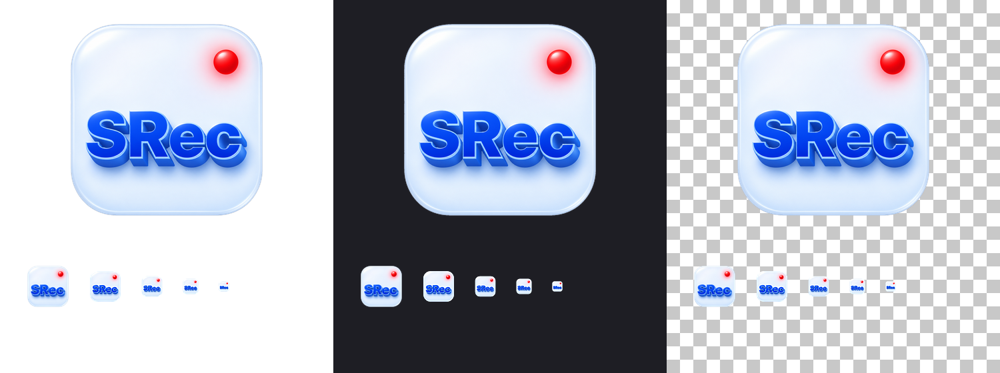
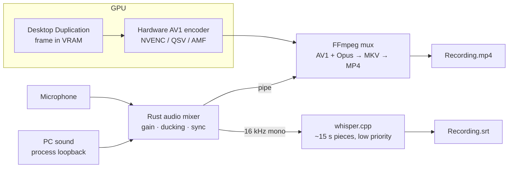

<p align="center">
  
</p>

<h1 align="center">SRec</h1>

<p align="center">
  <b>A light, offline AV1 screen recorder for Windows with live English subtitles.</b><br>
  Written in Rust · GPU zero-copy capture · Whisper-powered <code>.srt</code> subtitles · MIT licensed
</p>

<p align="center">
  <a href="https://github.com/YOUR-GITHUB-USERNAME/SRec/actions/workflows/build.yml"></a>
  <a href="https://github.com/YOUR-GITHUB-USERNAME/SRec/releases"></a>
  <a href="LICENSE"></a>
  
</p>

---

SRec records your screen, your microphone and your PC's sound into small AV1 MP4 files. While you record, it writes English subtitles that VLC and other players load automatically. It's controlled from a small floating "island" at the top of the screen, and the island never appears in your recordings.

Everything runs on your own PC: no account, no cloud, no telemetry and no internet connection.

> **Status: 1.0 alpha.** All features work, and the alpha is for wider testing before 1.0.
> Please report anything odd: see [Contributing](#contributing).

## Why SRec?

| | |
|---|---|
| **Your CPU stays free** | Frames are captured and encoded on the graphics card ("zero-copy"). Your CPU is left for the apps you're demonstrating. |
| **Small files** | AV1 video with capped constant quality: about **100–700 MB per hour of 1080p**, set by an hourly size target you choose. |
| **Subtitles while you record** | English `.srt` subtitles are written live in ~15-second pieces by [whisper.cpp](https://github.com/ggml-org/whisper.cpp), so they're ready seconds after you stop. |
| **Clear voice** | Automatic mic gain, plus PC sound lowered while you talk. PC sound is recorded at its real level, whatever the speaker volume is set to. |
| **Private by design** | Works fully offline. No network code, telemetry or auto-updater. |
| **Tiny and fast** | A 3 MB native Rust app. No runtime, no garbage collector, no background services. |

## Quick start

1. Download **`SRec-Setup-<version>.exe`** from [Releases](https://github.com/YOUR-GITHUB-USERNAME/SRec/releases).
2. Run it, accept the Terms of Use and finish the wizard. No admin rights are needed.
3. Start SRec. The island appears at the top of the screen and checks your graphics card for a few seconds.
4. Press **`Ctrl+Shift+R`** to start recording, and press it again to stop.
5. Click the island's status text to open the video. `Recording_….mp4` and `Recording_….srt` are in `Videos\SRec Recordings`.

Full guides: **[Installation](docs/INSTALLATION.md)** · **[User manual](docs/USER_MANUAL.md)** · **[Troubleshooting](docs/TROUBLESHOOTING.md)**

## Features

- **Automatic GPU encoder selection:** NVIDIA NVENC AV1 (RTX 40/50) → AMD AMF AV1 (RX 7000+) → Intel Quick Sync AV1 (Arc, Core Ultra) → SVT-AV1 on the CPU (any PC). SRec test-encodes real frames and caches the winner.
- **Zero-copy capture:** Desktop Duplication frames stay in GPU memory and go straight to the hardware encoder. GDI capture is the fallback for Remote Desktop and old drivers.
- **Record what you want:** the full screen, any window, or a dragged area (`Ctrl+Shift+S`). Works on any monitor.
- **Hourly size target:** 400 MB / 500 MB / 700 MB / 1 GB / 1.5 GB per hour, with a live projection of the hourly size while you record.
- **Audio:**
  - mic plus PC sound, mixed on the wall clock so audio never drifts from the video
  - automatic voice gain (up to +20 dB) and ducking of PC sound while you speak
  - PC sound recorded at its real level, not the speaker volume
- **Live English subtitles:**
  - offline Whisper `small.en`, with voice detection that skips silence and music
  - at most 4 low-priority CPU threads while recording
  - toggle with the **CC** button
- **Crash-safe:** records to MKV, then converts to MP4 in seconds without re-encoding. Subtitles are saved after every piece.
- **Unobtrusive:** the island is hidden from captures, has global hotkeys, and can be dragged anywhere.

## How it works



Read more in **[docs/ARCHITECTURE.md](docs/ARCHITECTURE.md)**.

## Requirements

- Windows 10 version 2004 (build 19041) or newer, or Windows 11, 64-bit.
- **Hardware AV1** (recommended): NVIDIA RTX 40-series or newer, AMD RX 7000 or newer, or Intel Arc / Core Ultra. Other PCs use SVT-AV1 on the CPU; a 6-core or better CPU is recommended for 1080p30.
- About 300 MB of disk space for the app, FFmpeg and the speech model.
- PC sound at its real level needs Windows 11 or Windows 10 build 20348+. Older builds fall back to classic loopback, which follows the speaker volume.

## Documentation

| Document | For |
|---|---|
| [docs/INSTALLATION.md](docs/INSTALLATION.md) | Installing, updating, uninstalling, portable use |
| [docs/USER_MANUAL.md](docs/USER_MANUAL.md) | Every control, setting and file SRec creates |
| [docs/TROUBLESHOOTING.md](docs/TROUBLESHOOTING.md) | Common problems and FAQ |
| [docs/ARCHITECTURE.md](docs/ARCHITECTURE.md) | How the code is organised and why |
| [docs/BUILDING.md](docs/BUILDING.md) | Building the app and installer from source |
| [docs/TESTING.md](docs/TESTING.md) | Automated tests and the pre-release test checklist |
| [docs/RELEASING.md](docs/RELEASING.md) | Versioning, alpha → 1.0, publishing releases |
| [CONTRIBUTING.md](CONTRIBUTING.md) | How to contribute |
| [CHANGELOG.md](CHANGELOG.md) | What changed in each version |

## Building from source

```powershell
git clone https://github.com/YOUR-GITHUB-USERNAME/SRec.git
cd SRec
powershell -ExecutionPolicy Bypass -File .\build.ps1
```

This builds `srec.exe` and downloads and verifies FFmpeg (LGPL) and whisper.cpp with its models. It then produces `dist\SRec-Setup-<version>.exe`. See [docs/BUILDING.md](docs/BUILDING.md) for prerequisites.

## Contributing

Bug reports, test results on different GPUs, and pull requests are all welcome. Please read [CONTRIBUTING.md](CONTRIBUTING.md) and the [Code of Conduct](CODE_OF_CONDUCT.md). Report security issues privately as described in [SECURITY.md](SECURITY.md).

## Licence

- SRec's own code is **MIT** licensed. See [LICENSE](LICENSE).
- The installer shows the [Terms of Use](TERMS-OF-USE.txt): lawful use, consent of people you record, and no warranty.
- Bundled components keep their own licences. See [THIRD-PARTY-NOTICES.txt](THIRD-PARTY-NOTICES.txt):
  - FFmpeg (LGPL build, run as a separate program)
  - whisper.cpp (MIT)
  - OpenAI Whisper model weights (MIT)
  - Silero VAD (MIT)

## Acknowledgements

SRec builds on:
- [FFmpeg](https://ffmpeg.org) and [BtbN's FFmpeg builds](https://github.com/BtbN/FFmpeg-Builds)
- [SVT-AV1](https://gitlab.com/AOMediaCodec/SVT-AV1)
- [whisper.cpp](https://github.com/ggml-org/whisper.cpp) and [OpenAI Whisper](https://github.com/openai/whisper)
- [Silero VAD](https://github.com/snakers4/silero-vad)
- [egui/eframe](https://github.com/emilk/egui), [cpal](https://github.com/RustAudio/cpal) and [windows-rs](https://github.com/microsoft/windows-rs)
