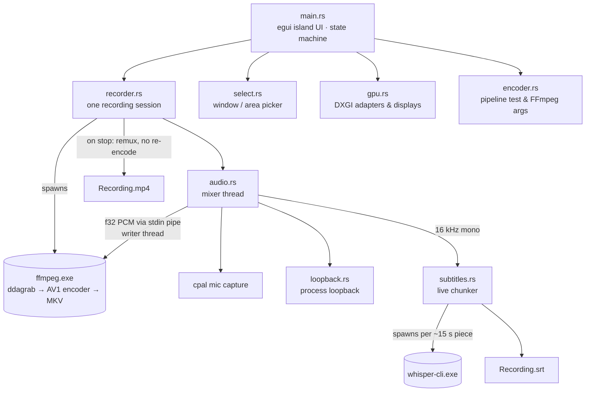

# Architecture

SRec is a single native Rust executable (`srec.exe`, ~3 MB). It drives two bundled helper programs: **FFmpeg** for capture, encoding and muxing, and **whisper.cpp** for speech recognition. Both run as separate processes, which keeps the licences clean (LGPL FFmpeg is never linked) and makes a crash in a helper unable to take down the app.



## Modules

| File | Responsibility |
|---|---|
| `src/main.rs` | The island UI (egui/eframe): drawing, hover/expand, settings rows, toasts. A small state machine `Phase` (Probing → Ready → Recording → Saving) drives everything. |
| `src/gpu.rs` | Lists graphics adapters (vendor, VRAM) and displays through DXGI. |
| `src/encoder.rs` | Finds `ffmpeg.exe`. Builds the candidate **pipelines** (encoder × capture method), test-encodes 10 real frames for each, and builds the FFmpeg arguments for capped constant-quality AV1. |
| `src/recorder.rs` | One recording: spawns FFmpeg (video from `ddagrab`/`gdigrab`, audio from `stdin`), starts audio and subtitles, stops gracefully, then remuxes MKV → MP4. |
| `src/audio.rs` | The mixer: mic + PC sound → automatic gain, ducking, soft clipping → FFmpeg; also feeds the subtitle tap. |
| `src/loopback.rs` | Windows *process loopback* capture of all PC sound before the speaker volume is applied. |
| `src/subtitles.rs` | Live subtitles: cuts audio into ~15 s pieces at quiet moments, runs `whisper-cli`, and merges and cleans the cues into one `.srt`. |
| `src/select.rs` | Full-screen overlay for picking a window (click), an area (drag) or a display (right-click). |
| `src/platform.rs` | Win32 helpers: global hotkeys, hiding the island from capture (`WDA_EXCLUDEFROMCAPTURE`), Explorer. |
| `src/config.rs` | `%APPDATA%\SRec\config.ini` load/save (plain `key=value`). |

## Video: zero-copy GPU capture

Most screen recorders copy every frame from the GPU to system memory, then the CPU converts colours and encodes it. SRec avoids that:

1. **Desktop Duplication** (`ddagrab` in FFmpeg) hands over each frame as a Direct3D 11 texture, which is already in video memory.
2. The texture goes straight to the **hardware AV1 encoder** (NVENC, AMF), or is mapped into Quick Sync memory (`hwmap=derive_device=qsv`). For Quick Sync, scaling also happens on the GPU (`scale_qsv`).
3. Only the compressed bitstream, a few hundred kbit/s, comes back to the CPU for muxing.

So for 1080p30 the CPU never touches ~250 MB/s of raw pixels (1920×1080 × 4 bytes × 30 fps). It's free for the apps being recorded.

The encoder probe tries pipelines best-first and keeps the first that works:

| Order | Pipeline | CPU work per frame |
|---|---|---|
| 1 | NVENC / AMF / QSV, `ddagrab` zero-copy | none (GPU only) |
| 2 | same encoders, frames downloaded to RAM | copy + optional scaling |
| 3 | SVT-AV1 (CPU), `ddagrab` download | full encode on CPU |
| 4 | GDI capture + any encoder | Remote Desktop / old drivers |

Limitation: with NVENC/AMF, *Max 1080p* scaling of a larger-than-1080p screen goes through system memory, because not every driver can resize zero-copy. Quick Sync scales on the GPU.

**Rate control** ("capped constant quality"): the encoder targets a quality level (`-cq`/CRF), with `maxrate` = the hourly budget and a 10–20 s VBV buffer, plus a 10 s GOP. Calm screens use a fraction of the budget; the budget is never exceeded.

**Crash safety:** FFmpeg writes Matroska (MKV), which stays readable after a crash. On stop, the audio pipe is closed; with `-shortest`, FFmpeg flushes and finalises the file. It's then remuxed to MP4 with `-c copy -movflags +faststart`, which takes seconds and doesn't re-encode.

## Audio

```
mic (cpal, any rate) ─► resample 48 kHz ─► queue ─┐
                                                   ├─► mixer (10 ms ticks, wall clock)
PC sound (process loopback, 48 kHz f32) ─► queue ─┘        │
                                                           ├─► writer thread ─► FFmpeg stdin (f32le)
                                                           └─► ÷3 downsample ─► subtitles (16 kHz mono)
```

- **Wall-clock mixer:** every 10 ms the mixer emits exactly the number of samples that real time requires, filling gaps with silence. Loopback delivers nothing while the PC is silent, so this is what keeps audio and video in sync for hours.
- **Never blocks:** FFmpeg 8 sometimes pauses reading its stdin for seconds to keep inputs aligned. The mixer hands chunks to a writer thread through an unbounded queue, so capture never stalls and nothing is dropped. Device queues hold 10 s.
- **Voice processing (`Voice`):** peak-envelope automatic gain (1×–10×, held during pauses), PC sound ducked to 0.35× while the user speaks, and a soft clipper.
- **Process loopback** (`AUDIOCLIENT_ACTIVATION_TYPE_PROCESS_LOOPBACK`, excluding SRec's own process tree) captures the apps' streams before the endpoint volume. Classic endpoint loopback is the fallback on older Windows.

## Subtitles

- The mixer's output (exactly what goes into the file) is downsampled to 16 kHz mono and sent to the subtitle thread.
- The thread cuts a piece when ≥17 s is buffered, at the quietest 20 ms between 12 s and 17 s, so cuts fall in pauses.
- Each piece is written as a WAV to `%TEMP%` and transcribed by `whisper-cli`. It runs at `BELOW_NORMAL_PRIORITY_CLASS` with 2–4 threads while recording (up to 8 after stop), with Silero VAD (`--vad`) and the previous ~200 characters as `--prompt` for continuity.
- Cue times are offset by the piece's position, clamped to the piece, and made monotonic. Non-speech cues (`[BLANK_AUDIO]`, `(music)`, `*laughs*`) are dropped.
- The `.srt` (UTF-8 BOM, CRLF) is rewritten after each piece, so it survives crashes.
- Silent pieces (peak < −66 dBFS) skip Whisper entirely.

## Threads

| Thread | Work |
|---|---|
| UI (main) | egui rendering: about 3 fps when idle, 10 fps while busy |
| `audio-mixer` | 10 ms mixing loop |
| `audio-writer` | blocking writes to FFmpeg stdin |
| `pc-sound` | process loopback capture loop |
| cpal stream threads | microphone (and classic loopback fallback) |
| `subtitles` | chunking and running whisper-cli |
| hotkeys | Win32 message loop for `RegisterHotKey` |

## Design principles

- **Offline and private:** no network code at all.
- **Fail soft:** if something optional fails (subtitles, VAD, process loopback, mic), recording continues and the island shows a warning.
- **Separate processes for heavy native code:** FFmpeg and whisper.cpp crashes can't corrupt the app, and their licences stay separate.
- **Small and dependency-light:** a handful of crates, `opt-level = "s"`, LTO, a stripped binary.
